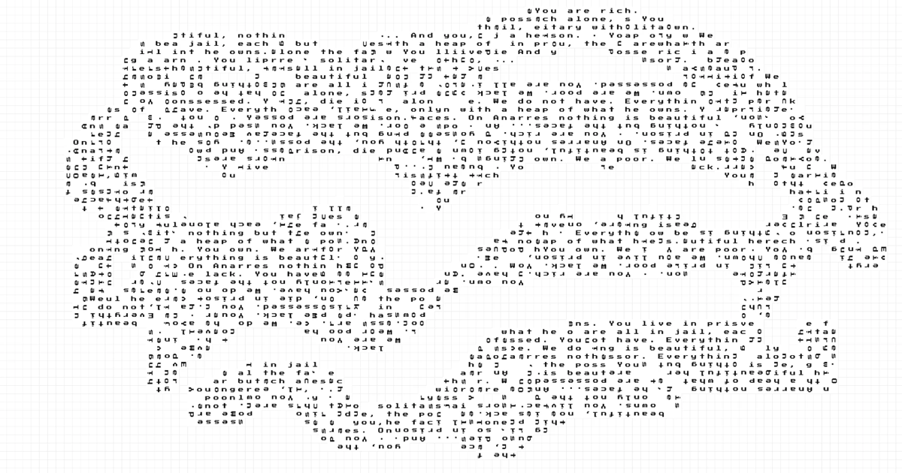

# ring_write

Paint a shape on the grid, and your words trace the walls, ring inside ring, like a tree keeping time.

A small typographic toy: one letter per cell, following the shape's rings from the outside in.

**Live:** https://dinefining.github.io/ring_write/



## Use it

- **Drag** on empty cells to paint, **drag** on painted cells to erase. Keys **1–5** set the brush size.
- Leave cells empty inside a shape to make holes; the text wraps around them.
- **Text** opens the text box; whatever you type flows into the rings.
- **Ctrl** has the brush, background / shape / line toggles, repeat or leave empty, undo, clear, reset, and JPG / PNG export.

## Run locally

```bash
git clone https://github.com/dinefining/ring_write.git
```

No build step. Any static server works:

```bash
node serve.mjs
```

Then open http://127.0.0.1:5173.

## How it works

- `js/grid.js`: painted cells → outline loops (traced edge by edge).
- `js/rings.js`: insets the outline one cell at a time with square corners, using [Clipper](https://github.com/junmer/clipper-lib) (bundled in `vendor/`), so every ring runs through cell centres.
- `js/layout.js`: walks each ring cell by cell and gives every cell one letter. Corner cells stay empty only at real corners (both sides 3+ cells), so corners read as a clean frame. Whatever the rings leave over is filled with plain horizontal, then vertical, lines.
- `js/render.js`: canvas drawing on whole pixels, in Press Start 2P (8px letters in 12px cells, always sharp).
- `js/input.js`: paint and erase.
- `js/panel.js`: the Text and Ctrl panels.
- `js/io.js`: export.

## Publish

It's plain static files, so GitHub Pages serves it as is: repo **Settings → Pages → Deploy from a branch → `main` / root**.

Work is autosaved in the browser. Earlier versions live in git history (the freehand one on the `organic` branch).

A maybe machine by Ravi Popat.
